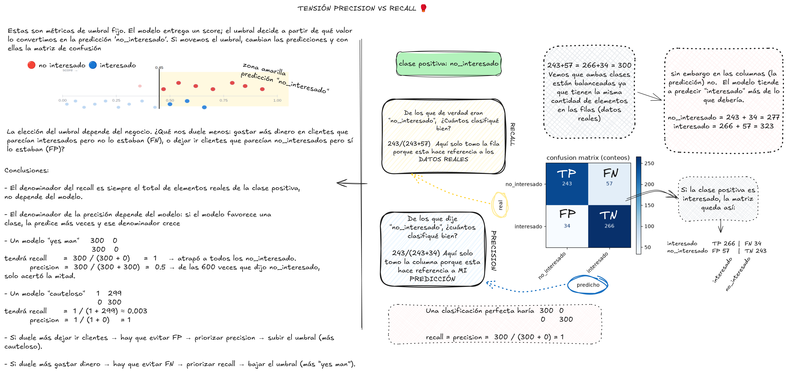

# Diagnóstico y mediciones para algoritmos de ML de clasificación

Supongamos un investigador/ingeniero ML llamado Ignasio en una empresa ficticia llamada la "Empresa Feliz". La Empresa Feliz invierte dinero en campañas de marketing (llamadas, descuentos, regalos) para vender un producto nuevo, y Ignasio tiene la tarea de entrenar un modelo que clasifique correctamente a cada cliente como **interesado** o **no_interesado**, para no gastar presupuesto en quien no va a comprar.

Para ello se le suministran permisos de acceso en base de datos para consultar campañas históricas: qué clientes se contactaron y si de verdad estaban interesados.

A lo largo de todo el documento la **clase positiva es `no_interesado`**: el score del modelo es "qué tan probable es que este cliente **no** esté interesado", y "acertar un positivo" significa detectar a un cliente en el que no vale la pena gastar. Ignasio está feliz porque usó pytorch para crear su MLP con el módulo `n.n`, sin embargo después de un entrenamiento de varios días con su pc encendido consumiendo electricidad con su RTX 5070 viene una pregunta muy importante y fundamental: **¿Esto si está aprendiendo a clasificar?**

Específicamente, los algoritmos de clasificación como los MLP, random forest, SVM etc tiene una clara función y es que basado en los datos de entrenamiento, los "engranajes internos" del algoritmo se acomodan para **generalizar** los datos, y ante uno nuevo totalmente desconocido es capaz de reconocer los patrones y decir a qué categoría es propable que pertenezca

Por lo cual, lo que sigue son los conceptos fundamentales y mas importantes para concluir si Ignasio está haciendo bien su trabajo y no será despedido de la Empresa Feliz

## Parte 1 — Los cimientos

### 1.1 ¿Qué significa "generalizar"?

En la "Escuela Feliz" dos estudiantes de octavo grado cursan por primera vez álgebra 1, una materia que suele ser retadora para todos los estudiantes. El estudiante A tiene la costumbre de aprenderse de memoria todos los ejercicios que el profesor propone, mientras que el estudiante W intenta entender el por qué de todos los procesos y trucos aritméticos que se enseñan en la clase

El día del examen del primer corte el profesor usa preguntas de talleres que envió a los estudiantes durante las semanas previas al examen. En este caso, ambos el estudiante A y W aprueban con una nota alta. Sin embargo, para el segundo corte el profesor decide usar algunas preguntas nuevas que ningún estudiante ha visto, pero que conservan el espíritu y los mecanismos de otros ejemplos compartido en los talleres

Podemos imaginar el resultado, cuando el estudiante A ve las preguntas nuevas no puede resolverlas y repureba el examen. El estudiante W entiende el por qué de todo y logra responder la mayoría bien, aprobando.

Vale la pena mencionar que si el profesor evaluara cálculo integral en vez de álgebra, ni siquiera W aprobaría, y no sería justo llamarlo "mala generalización".

---
Usando la terminología técnica, existe una **real distribution** (distribución real) de problemas de álgebra, que llamaremos *D*, con todos los ejercicios posibles de álgebra 1, tanto los que ya se resolvieron en clase como los que nunca se han planteado. Ni el estudiante A ni el estudiante W tienen acceso a *D* completa. Lo único que vieron fueron los talleres de las semanas previas, que son un **sample** (muestra finita) de esa distribución. A esa muestra la llamaremos *S*.

Cuando el estudiante A se aprende de memoria los ejercicios de los talleres, está minimizando su error sobre *S*, la muestra que sí tuvo enfrente. A eso se le llama **empirical risk** (riesgo empírico), y mide qué tan seguido se equivoca en los ejemplos que ya conoce. Por eso le va bien en el primer corte, porque el profesor evaluó con preguntas sacadas de *S*.

Para saber si alguien de verdad aprendió álgebra hay que mirar *D*, es decir, su capacidad de responder cualquier ejercicio, incluidos los que nunca vio. El error sobre toda la distribución se llama **true risk** (riesgo verdadero). El estudiante W lo tiene bajo porque entendió los mecanismos de fondo, mientras que el estudiante A lo tiene por las nubes aunque su empirical risk sea casi cero.

**Generalizar significa que el true risk también sea bajo, además del empirical risk.** Con el segundo corte, que usa preguntas nuevas parecidas a las de los talleres, el profesor intenta estimar el true risk. Toma una segunda muestra que los estudiantes no vieron y la usa para descubrir quién entendió y quién solo memorizó. Los **test data** (datos de prueba) van a cumplir ese mismo papel con el modelo de Ignasio.


### 1.2 Primero se mide el score, después la decisión

El modelo no dice directamente "este cliente no está interesado". Ajusta una recta y la aplana con la sigmoide para dar un número entre 0 y 1 (un **score**), que se interpreta como "qué tan probable es `no_interesado`". La decisión (`no_interesado` o `interesado`) es un paso aparte en el que se compara ese score con un umbral, que normalmente es `0.5`.

Si evaluamos solo la decisión final perdemos información. Un score de `0.51` y uno de `0.9` caen del mismo lado del umbral, pero el segundo lo dice con mucha más **confianza**. Esa diferencia ayuda a saber si el modelo entendió el problema o si está **adivinando** cerca del borde.

Por eso conviene evaluar el score antes de hablar de umbrales. Hay dos cualidades que se miden por separado.

- **Ordenar bien**. ¿El modelo les da un score más alto a los `no_interesado` de verdad que a los `interesado`? Aquí importa el orden relativo y no el valor exacto. Un modelo que da `0.05` a los `no_interesado` y `0.02` a los `interesado` ordena perfecto aunque ningún score parezca alto.
- **Que el número sea una probabilidad creíble**. Si el modelo dice `0.8`, ¿de verdad alrededor del 80% de los casos en los que dijo algo cercano a `0.8` resultaron `no_interesado`? Un modelo puede ordenar perfecto y aun así estar mal calibrado, por ejemplo si dice `0.95` cuando la tasa real ronda el 60%.

#### Ejemplo 1 — Ordenar bien

Seis clientes y dos modelos con scores distintos.

| cliente | real          | Modelo A | Modelo B |
|---------|---------------|----------|----------|
| c1      | no_interesado | 0.90     | 0.09     |
| c2      | no_interesado | 0.85     | 0.085    |
| c3      | no_interesado | 0.70     | 0.07     |
| c4      | interesado    | 0.30     | 0.03     |
| c5      | interesado    | 0.20     | 0.02     |
| c6      | interesado    | 0.10     | 0.01     |

Los dos modelos **ordenan igual** (ambos tienen AUC = 1.0, separación perfecta), aunque el Modelo B nunca da un número que parezca `no_interesado` (su máximo es `0.09`).

> Para ordenar bien basta con que cada `no_interesado` quede arriba de cada `interesado`. Un `no_interesado` con `0.09` y un `interesado` con `0.01` están bien ordenados aunque ningún número supere `0.5`.

Esto es lo que miden **ROC / AUC** y **PR / AP**.

#### Ejemplo 2 — Que el número sea una probabilidad creíble (calibración)

El modelo "dice 80%" en el momento en que asigna `0.8`. Comprobar si ese número es honesto viene después, juntando todos los casos donde dijo `0.8` y mirando qué pasó en realidad.

##### Un solo nivel (el 0.8)

De 10 clientes a los que el modelo les dio un score cercano a `0.8`:

- **Calibrado.** 8 resultaron `no_interesado`, o sea el 80%, y el número es creíble.
- **Mal calibrado (sobreconfiado).** Solo 6 resultaron `no_interesado`. El modelo dice `0.8`, pero la tasa real ronda el 60%.

##### Todos los niveles a la vez (reliability diagram)

Se hace lo mismo pero agrupando en **rangos (baldes)**, porque los scores son continuos.

| balde de score | modelo dice (promedio) | pasó de verdad |
|----------------|------------------------|-----------------|
| [0.0, 0.2)     | ~0.10                  | ¿qué fracción fue no_interesado? |
| [0.2, 0.4)     | ~0.30                  | ¿qué fracción fue no_interesado? |
| [0.4, 0.6)     | ~0.50                  | ¿qué fracción fue no_interesado? |
| [0.6, 0.8)     | ~0.70                  | ¿qué fracción fue no_interesado? |
| [0.8, 1.0]     | ~0.90                  | ¿qué fracción fue no_interesado? |

Un modelo bien calibrado tiene, en **cada** balde, "lo que dice" ≈ "lo que pasó".

> **Analogía.** Un pronosticador que dice "80% de lluvia" ya hizo su predicción en ese momento. Si es bueno o no se sabe después, revisando si llovió en 8 de cada 10 días en los que dijo "80%". El modelo es el pronosticador, el score es el "80%" y la calibración es revisar su historial.

Esto es lo que miden **reliability diagram**, **ECE** y **Brier score**.

##### Son independientes

- El **Modelo B** del ejemplo 1 ordena perfecto, pero sus números (`0.09`, `0.01`) son demasiado bajos. Tiene buena discriminación y mala calibración.
- Un modelo **sobreconfiado** puede ordenar perfecto e inflar los números (dice `0.8` cuando la tasa real es 60%). También tiene buena discriminación y mala calibración.
- Un modelo que le asigna a **todos** los clientes la prevalencia (por ejemplo `0.4`) está calibrado en agregado, pero no distingue a nadie. Tiene mala discriminación y buena calibración.

Como son independientes, se miden con herramientas distintas. Un modelo puede ordenar muy bien con números desviados, o tener números creíbles y ordenar mal. **ROC/AUC y PR/AP** miden el orden (Parte 3), y el **reliability diagram, ECE y Brier** miden si el número es creíble (Parte 4).


### 1.3 La matriz de confusión: TP, FP, FN, TN

Una vez tomada la decisión (score contra umbral), se compara con la realidad y salen cuatro casos. Las **filas son la realidad** y las **columnas son la predicción**, que es la misma disposición que usa `sklearn.metrics.confusion_matrix` y la imagen de la sección de tensión precision–recall.

| | Predicho: no_interesado | Predicho: interesado |
|---|---|---|
| **Real: no_interesado** | True Positive (TP) | False Negative (FN) |
| **Real: interesado** | False Positive (FP) | True Negative (TN) |

- **TP**: era `no_interesado` y el modelo dijo `no_interesado`. Lo detectamos y no gastamos nada en él.
- **TN**: era `interesado` y el modelo dijo `interesado`. Le enviamos la campaña y la aprovecha.
- **FP**: era `interesado` y el modelo dijo `no_interesado`. Es un cliente que sí quería comprar y lo dejamos ir sin ofrecerle nada.
- **FN**: era `no_interesado` y el modelo dijo `interesado`. Gastamos presupuesto de campaña en alguien que nunca iba a comprar.

Con esta matriz se calculan precision, recall, F1 y accuracy (Parte 2), que son distintas formas de combinar estos cuatro números. Hay que tener en cuenta que la matriz depende del umbral. Al moverlo, unos casos pasan de TP a FN (o al revés) y otros de FP a TN (o al revés), así que la matriz cambia entera.

### 1.4 El umbral de decisión

El `0.5` es solo la convención por defecto. El umbral se aplica después del modelo y cambiarlo es tan fácil como editar una línea de código, pero al moverlo cambia toda la matriz.

Ignasio corre el modelo sobre 20 clientes de validación. Ocho eran `no_interesado` de verdad, con scores:

`0.93, 0.85, 0.79, 0.70, 0.62, 0.54, 0.47, 0.36`

Doce eran `interesado` de verdad:

`0.66, 0.58, 0.50, 0.43, 0.37, 0.31, 0.26, 0.20, 0.15, 0.10, 0.06, 0.02`

Los dos grupos se solapan. Hay un `interesado` con score `0.66`, más alto que un `no_interesado` con `0.36`. Eso es lo normal en un modelo real, y es justamente lo que hace que importe dónde se pone el umbral.

- **Umbral `0.5`**. Pasan el umbral seis `no_interesado` (TP) y dos se quedan por debajo (FN). De los `interesado` pasan tres (FP) y nueve se quedan por debajo (TN). En total quedan **6 TP, 3 FP, 2 FN, 9 TN**.
- **Umbral `0.35`**. Pasan los ocho `no_interesado` (0 FN), pero también cinco `interesado`, así que quedan **8 TP, 5 FP, 0 FN, 7 TN**. No se gasta nada en clientes no interesados, a cambio de dejar ir a más clientes interesados.
- **Umbral `0.65`**. Cuatro `no_interesado` quedan por debajo (FN) y solo un `interesado` sigue pasando (FP), así que quedan **4 TP, 1 FP, 4 FN, 11 TN**. Casi no se deja ir a nadie interesado, pero se gasta campaña en la mitad de los no interesados.

Ningún score cambió entre los tres escenarios. Solo se movió el umbral, y eso bastó para reacomodar toda la matriz. Por eso no tiene sentido decir "mi modelo tiene 90% de precision" sin aclarar a qué umbral se midió.

> Simulador interactivo: [html/score_umbral_metricas_prevalencia.html](html/score_umbral_metricas_prevalencia.html). Cubre desde el riesgo empírico y el verdadero (1.1) hasta la prevalencia (2.5). Un slider mueve el umbral sobre los mismos 20 clientes y recalcula en vivo la matriz de confusión, precision, recall, accuracy y FPR. Otro slider cambia la prevalencia y muestra cómo cae precision al pasar de validación a producción.

¿Quién decide dónde poner el umbral? El negocio. Bajar el umbral favorece recall (se detectan más `no_interesado` y se desperdicia menos presupuesto), pero deja ir a más clientes interesados. Subirlo favorece precision (casi no se descarta a nadie interesado), pero se gasta más en clientes que no iban a comprar. Cuál de los dos errores sale más caro se ve en la Parte 6 (matriz de costos). Por ahora basta con saber que el umbral se elige aparte del modelo.

## Parte 2 — Métricas a UN umbral fijo (un punto)

### 2.1 Precision

Con umbral `0.5` (6 TP, 3 FP, 2 FN, 9 TN):

> De todas las veces que el modelo dijo "`no_interesado`", ¿cuántas veces tenía razón?

```
precision = TP / (TP + FP)
```

Precision solo mira la **columna** "Predicho: `no_interesado`", o sea, se fija en *lo que predijo el modelo*. El modelo marcó `no_interesado` nueve veces y acertó seis, así que precision = 6/9 ≈ 0.67. Dos de cada tres clientes descartados de verdad no estaban interesados, y el tercero es un cliente interesado que dejamos ir sin ofrecerle nada.

¿Por qué le importa a la Empresa Feliz? Cada FP es una venta perdida, un cliente que quería el producto y nunca recibió la oferta. Si precision es baja, el modelo está descartando clientes valiosos y el equipo comercial deja de confiar en él.

Caso extremo. Un modelo "cauteloso" que casi nunca dice `no_interesado` (solo cuando está segurísimo) puede tener precision 1.0 y aun así detectar muy pocos. Una precision alta quiere decir que cuando el modelo descarta a alguien casi nunca se equivoca. Cuántos no interesados detecta en total lo mide recall.

### 2.2 Recall

Precision mira la columna "Predicho: `no_interesado`". **Recall** mira la **fila** "Real: `no_interesado`", es decir, se fija en *los datos reales*.

> De todos los clientes que de verdad eran `no_interesado`, ¿cuántos detectó el modelo?

```
recall = TP / (TP + FN)
```

Con umbral `0.5` (6 TP, 2 FN), recall = 6/8 = 0.75. El modelo detectó tres de cada cuatro y se le escaparon los dos `no_interesado` con score más bajo (`0.47` y `0.36`), en los que se termina gastando campaña. En ese mismo umbral precision era 0.67. Los números se parecen, pero las dos métricas miden cosas distintas.

Con umbral `0.65` (4 TP, 4 FN), recall = 4/8 = 0.5. Al subir el umbral, precision subió de 0.67 a 0.8, pero recall bajó de 0.75 a 0.5.

> A recall no le importa cuántos interesados se descartan por error. Solo cuenta cuántos `no_interesado` reales se detectaron. También se le llama **sensitivity** o **true positive rate**, y vuelve a aparecer en la curva ROC (Parte 3).

¿Por qué le importa a la Empresa Feliz? Cada FN es dinero de campaña gastado en alguien que nunca iba a comprar. Si gastar en un no interesado cuesta más que dejar ir a un interesado, conviene un recall alto aunque baje precision. Cómo elegir el umbral correcto se retoma en la Parte 6.

El caso extremo contrario es un modelo "yes man" que marca a *todos* como `no_interesado`. Tiene recall 1.0 (no gasta en nadie porque no contacta a nadie), pero su precision es pésima. Ninguno de los dos extremos sirve, y de eso trata la siguiente sección.

### La tensión precision–recall (por qué no se pueden maximizar las dos)

Al mover el umbral de 0.5 a 0.65, Ignasio ganó precision (de 0.67 a 0.8) y perdió recall (de 0.75 a 0.5). Esto no fue mala suerte, siempre pasa algo parecido.

Con `umbral = 0` todos quedan marcados como `no_interesado`. Recall = 8/8 = 1.0 y precision = 8/20 = 0.4, que es exactamente el base rate. Con `umbral = 1` no se marca a nadie, precision queda indefinida (0/0) y recall = 0.

Entre esos dos extremos, cada caso que deja de pasar el umbral al subirlo era antes un TP o un FP. Si era un FP, precision sube. Si era un TP, se convierte en FN y recall baja. En la práctica pasan las dos cosas a la vez, así que las métricas se mueven en direcciones opuestas.

La razón es que TP y FP están del mismo lado del umbral (los dos son "predicho `no_interesado`"), así que cualquier movimiento los afecta juntos. Ningún umbral maximiza las dos métricas a la vez, salvo que el clasificador sea perfecto y los grupos no se solapen.



La misma tensión se ve con más datos. Ignasio evalúa sobre 600 clientes (300 `no_interesado` y 300 `interesado`) con umbral `0.45` y obtiene esta matriz.

| | Predicho: no_interesado | Predicho: interesado |
|---|---|---|
| **Real: no_interesado** | TP = 243 | FN = 57 |
| **Real: interesado** | FP = 34 | TN = 266 |

```
recall    = 243 / (243 + 57) = 243/300 ≈ 0.81    ← solo la fila (datos reales)
precision = 243 / (243 + 34) = 243/277 ≈ 0.877   ← solo la columna (mi predicción)
```

Las filas están balanceadas (`243+57 = 266+34 = 300`), pero las columnas no. El modelo predijo `no_interesado` 277 veces e `interesado` 323, o sea que tiende a decir "interesado" más de lo que debería. De aquí salen dos conclusiones.

- El denominador de recall siempre es el total real de la clase positiva (300), y eso no depende del modelo.
- El denominador de precision sí depende del modelo. Si el modelo favorece una clase, la predice más veces y ese denominador crece.

Los dos extremos sobre los mismos 600 clientes serían estos.

- Modelo **"yes man"** (marca todo como `no_interesado`), con matriz `[[300, 0], [300, 0]]`. Recall = 300/300 = 1 y precision = 300/600 = 0.5, porque de las 600 veces que dijo `no_interesado` solo acertó la mitad.
- Modelo **"cauteloso"** (casi nunca dice `no_interesado`), con matriz `[[1, 299], [0, 300]]`. Recall = 1/300 ≈ 0.003 y precision = 1/1 = 1.
- Una clasificación perfecta, `[[300, 0], [0, 300]]`, daría recall = precision = 1.

La elección del umbral depende de qué le duela más al negocio.

- Si duele más **dejar ir clientes** interesados → evitar FP → priorizar precision → **subir** el umbral (más "cauteloso").
- Si duele más **gastar dinero** en no interesados → evitar FN → priorizar recall → **bajar** el umbral (más "yes man").

Hay que tener en cuenta que TP, FP, FN y TN se definen respecto a la clase positiva. Si la clase positiva fuera `interesado`, la misma matriz quedaría como TP = 266, FN = 34, FP = 57, TN = 243, y precision y recall cambiarían.

Por eso decir "mi modelo tiene 95% de precision" está incompleto si no se dice a qué umbral, y comparar modelos con una sola métrica puede ser engañoso porque alguien pudo haber movido el umbral. Para eso sirve resumir las dos métricas en un número (F1) o comparar modelos sin elegir umbral (curva PR, Parte 3).

### F1 (y por qué usa la media armónica)

Lo primero que uno pensaría es promediar, `(precision + recall) / 2`. El problema es que eso puede engañar.

Tomemos el modelo "yes man" que marca a *todos* como `no_interesado`. Su recall es 1.0, pero si solo el 1% de los clientes es `no_interesado`, su precision ronda 0.01. La media aritmética da `(0.01 + 1.0)/2 = 0.505`, que parece aceptable, cuando en realidad el modelo descarta a todo el mundo y la empresa no le vende a nadie.

Con la media aritmética, un número alto puede tapar a uno bajo. Hace falta una media que castigue fuerte cuando cualquiera de los dos es malo. Esa es la **media armónica**, y con ella se define **F1**.

```
F1 = 2 · (precision · recall) / (precision + recall)
```

Con el modelo "yes man", `F1 = 2·(0.01·1.0)/(0.01+1.0) ≈ 0.0198`, y ahí sí queda claro que es malo, porque la media armónica queda dominada por el valor más pequeño. Cuando precision y recall son parecidos, F1 se acerca a la media aritmética. La diferencia solo se nota cuando uno de los dos es bajo.

Con los números de Ignasio a umbral `0.5` (precision ≈ 0.67, recall = 0.75), `F1 ≈ 0.706`, un valor entre los dos.

Hay dos cosas a tener en cuenta.

- F1 también se calcula a un **umbral fijo**, así que tiene el mismo problema de 1.4. Si cambia el umbral, cambia F1.
- F1 le da el mismo peso a precision y a recall, como si a la Empresa Feliz le doliera igual un FP que un FN. Casi nunca es así (Parte 6). Para esos casos existe **F-beta**, que le da más peso a una de las dos. F1 es el caso de esa familia en el que ambas pesan igual.

### Accuracy y por qué engaña con clases desbalanceadas

Es la métrica más obvia.

> ¿Qué fracción de todas las predicciones fueron correctas?

```
accuracy = (TP + TN) / (TP + FP + FN + TN)
```

Con umbral `0.5` (6 TP, 3 FP, 2 FN, 9 TN), accuracy = 15/20 = 0.75. Con `0.35` y con `0.65` también da 15/20 = 0.75. En esos tres umbrales precision va de 0.62 a 0.8 y recall de 1.0 a 0.5, pero accuracy da el mismo número las tres veces. Eso ya es una señal de alerta.

El problema se vuelve grave cuando las clases están desbalanceadas. Supongamos que la Empresa Feliz lanza la campaña sobre su base de **clientes fieles**, que ya compraron productos anteriores. Ahí casi todos están interesados, y los `no_interesado` pueden ser entre el 0.5% y el 1%, muy lejos del 40% del set de validación de Ignasio.

Con 10,000 clientes de los cuales 100 (1%) son `no_interesado`, un modelo perezoso que siempre dice "`interesado`" obtiene 0 TP, 0 FP, 100 FN y 9,900 TN.

```
accuracy = 9900 / 10000 = 0.99
```

Saca **99% de accuracy** sin detectar a un solo `no_interesado`. Su recall es 0 y su precision queda indefinida (0/0).

Accuracy cuenta todos los aciertos por igual. Cuando una clase domina, basta con acertar en ella para que el número suba, aunque el modelo falle en la clase que de verdad importa. Con clases más o menos balanceadas (40/60) el efecto se nota poco, pero con un desbalance fuerte la clase minoritaria, que es la que le interesa a Ignasio, casi no pesa en el resultado.

En resumen, accuracy solo es confiable cuando las clases están razonablemente balanceadas. Si la clase positiva es rara (no interesados entre clientes fieles, fraude, spam, enfermedades raras), conviene mirar precision, recall y F1 sobre la clase positiva.

### FPR (false positive rate), el espejo de recall

Recall mira la fila "Real: `no_interesado`". Se puede hacer la misma pregunta sobre la otra fila.

> De los clientes que de verdad eran `interesado`, ¿a cuántos marqué `no_interesado` y dejé ir?

```
FPR = FP / (FP + TN)
```

Con la matriz a umbral `0.5` (3 FP, 9 TN), FPR = 3/12 = 0.25. Uno de cada cuatro clientes interesados se queda sin oferta.

FPR es una métrica tan útil como recall. Su complemento, `1 − FPR = TN/(FP+TN)`, se llama **specificity** (o *true negative rate*) y se usa mucho en medicina junto a *sensitivity*, que es otro nombre para recall.

FPR vuelve a aparecer en dos lugares. Junto con recall explica por qué precision depende de la prevalencia (siguiente sección), y es el eje horizontal de la curva ROC (Parte 3).

### Base rate o prevalencia (por qué precision cambia con la prevalencia y recall no)

El **base rate** o **prevalencia** (**π**) responde esta pregunta.

> De todos los clientes, ¿qué fracción **de verdad** es `no_interesado`?

Para calcularla no hace falta el modelo. Ignasio podría sacarla de la base de datos de campañas históricas sin haber entrenado nada. En sus 20 clientes de validación, 8 eran `no_interesado` y 12 `interesado`, así que π = 8/20 = 0.4 (el 40% de los clientes no iba a comprar).

¿Por qué entonces se escribe con las letras de la matriz de confusión? Porque los 8 `no_interesado` reales quedan repartidos en las dos celdas de la fila "Real: `no_interesado`", según lo que haya predicho el modelo.

| | Predicho: no_interesado | Predicho: interesado |
|---|---|---|
| **Real: no_interesado** | TP = 6 (los detectó) | FN = 2 (se le escaparon) |
| **Real: interesado** | FP = 3 | TN = 9 |

Al sumar TP + FN se recuperan **todos** los `no_interesado` reales, los que el modelo acertó y los que no.

```
π = (TP + FN) / total = (6 + 2) / 20 = 8/20 = 0.4
```

Si Ignasio mueve el umbral a `0.65`, el reparto cambia (4 TP, 4 FN), pero la suma sigue siendo 8. Con cualquier otro modelo pasa lo mismo. TP y FN se reparten distinto, pero π se queda igual porque solo depende de cuántos `no_interesado` hay en la población.

π también mide qué tan desbalanceadas están las clases. Con π = 0.4 están casi parejas. Con π = 0.01 (los clientes fieles de la sección de accuracy), un modelo perezoso que siempre dice "`interesado`" saca 99% de accuracy. Eso no quiere decir que π = 0.5 sea un valor ideal al que haya que llegar. π es un dato de la población, y 0.5 es simplemente el caso en que las clases están parejas y accuracy es más fácil de interpretar. Cuando π se aleja de 0.5 hay que dejar de confiar en accuracy y mirar precision, recall y F1. Además, conviene evaluar el modelo con la π que va a encontrar en producción, en vez de con un set balanceado a mano.

En el set de validación π era 0.4, y en producción, sobre la base de clientes fieles, ronda el 1% o menos. Esa diferencia cambia mucho cuánto se puede confiar en precision, pero no afecta a recall.

```
recall    = TP / (TP + FN)
precision = TP / (TP + FP)
```

`recall` solo usa TP y FN, que juntos son *todos* los `no_interesado` reales (`TP+FN = π·total`). Por eso no depende de cuántos `interesado` haya. Mide qué tan bien detecta el modelo a la clase `no_interesado`.

`precision` tiene FP en el denominador, y los FP vienen de la clase negativa, que es enorme cuando `no_interesado` es raro. Aunque el FPR sea pequeño, aplicado sobre tantísimos `interesado` produce una cantidad de FP que puede superar a los TP.

Si en la fórmula de precision se reemplaza `TP = recall·π·total` y `FP = FPR·(1−π)·total` (el `total` se cancela), queda esto.

```
precision = (recall · π) / (recall · π + FPR · (1 − π))
```

Es la misma precision de siempre, escrita con otras variables. Recall y FPR dependen del modelo y del umbral, y no cambian con la población. π depende de *dónde* se usa el modelo. Es la misma cuenta del teorema de Bayes para calcular la probabilidad de estar enfermo dado un test positivo.

Apliquémoslo a Ignasio. En validación (π=0.4, recall=0.75, FPR=0.25) la precision fue 0.67. En producción (π=0.01), con el mismo modelo y el mismo umbral, da esto.

```
precision = (0.75·0.01) / (0.75·0.01 + 0.25·0.99) ≈ 0.029
```

Precision cae de 0.67 a menos del 3%, mientras recall sigue en 0.75. Del modelo no cambió nada, solo la proporción de `no_interesado` en la población. En números absolutos, sobre 10,000 clientes con 100 `no_interesado`, el modelo detectaría 75 (TP) pero dejaría ir a 2,475 clientes interesados (FP).

Con `umbral = 0` (recall=1, FPR=1) la fórmula se reduce a `precision = π`. Es la precision de un modelo que marca a todos como `no_interesado`, y sirve como referencia. Un modelo cuya precision no supera π no está aportando nada.

En la práctica, una precision medida en un set más balanceado que la realidad **no se mantiene en producción**. Decir "mi modelo tiene 67% de precision" sin decir a qué prevalencia está tan incompleto como no decir a qué umbral. Recall, en cambio, se mantiene entre poblaciones distintas. Por eso, cuando la clase positiva es muy rara, hay que medir precision con la prevalencia real, y en la Parte 3 se ve cómo hacerlo con la curva PR.


## Parte 3 — Métricas que barren TODOS los umbrales (una curva)

> Simulador interactivo: [html/roc_pr_calibracion.html](html/roc_pr_calibracion.html). Continúa el simulador de la Parte 1-2 con los mismos 20 clientes. Un mismo umbral recorre a la vez la curva ROC y la curva PR (Parte 3). Un slider de prevalencia muestra por qué la curva PR cae en producción mientras la ROC se queda igual. Y una transformación de temperatura muestra la diferencia entre discriminación y calibración, con su reliability diagram, ECE y Brier en vivo (Parte 4).

### ROC y AUC

Todas las métricas de la Parte 2 se calculan a un umbral fijo. Otra opción es preguntar qué tan bien ordena el modelo los scores sin elegir ningún umbral, que es la cualidad de "ordenar bien" de 1.2. Eso es lo que mide la curva **ROC** (*Receiver Operating Characteristic*).

Se recorre el umbral de 1 a 0 y en cada posición se anota esto.

```
TPR (recall) = TP / (TP + FN)
FPR          = FP / (FP + TN)
```

Cada punto (FPR, TPR) resume una matriz de confusión completa, y al recorrer todos los umbrales se forma una curva.

Así queda con los 20 clientes de Ignasio, ordenados por score y acumulando TP y FP.

| score | real | TP acum. | FP acum. | TPR (recall) | FPR |
|---|---|---|---|---|---|
| 0.93 | no_interesado | 1 | 0 | 0.125 | 0 |
| 0.85 | no_interesado | 2 | 0 | 0.25 | 0 |
| 0.79 | no_interesado | 3 | 0 | 0.375 | 0 |
| 0.70 | no_interesado | 4 | 0 | 0.5 | 0 |
| 0.66 | interesado | 4 | 1 | 0.5 | 0.083 |
| 0.62 | no_interesado | 5 | 1 | 0.625 | 0.083 |
| 0.58 | interesado | 5 | 2 | 0.625 | 0.167 |
| 0.54 | no_interesado | 6 | 2 | 0.75 | 0.167 |
| 0.50 | interesado | 6 | 3 | 0.75 | 0.25 |
| 0.47 | no_interesado | 7 | 3 | 0.875 | 0.25 |
| 0.43 | interesado | 7 | 4 | 0.875 | 0.333 |
| 0.37 | interesado | 7 | 5 | 0.875 | 0.417 |
| 0.36 | no_interesado | 8 | 5 | 1.0 | 0.417 |

A partir de ahí, los siete `interesado` que faltan solo suben FPR de 0.417 a 1.0 sin mover recall, hasta llegar a (1, 1) con `umbral = 0`.

Tres de estas filas, `0.50` (recall=0.75, FPR=0.25), `0.66` (recall=0.5, FPR=0.083) y `0.36` (recall=1.0, FPR=0.417), corresponden a los tres umbrales de 1.4. Ahora son tres puntos de la misma curva.

Al unir todos los puntos desde (0,0) hasta (1,1) se obtiene la curva ROC. Un modelo perfecto sube pegado al eje vertical hasta (0,1) y luego va recto hasta (1,1). Un modelo que adivina al azar sigue la diagonal de (0,0) a (1,1).

El **AUC** (*area under the curve*) resume la curva en un número. El modelo de Ignasio tiene AUC ≈ 0.885.

Una forma intuitiva de leerlo es esta. Si se toma al azar un `no_interesado` y un `interesado`, el AUC es la probabilidad de que el modelo le dé un score más alto al `no_interesado`. De los 8×12 = 96 pares posibles, en 85 el `no_interesado` queda arriba, y 85/96 ≈ 0.885. AUC = 0.5 es azar puro y AUC = 1.0 es separación perfecta.

El AUC no depende de ningún umbral porque resume la curva entera. Por eso sirve para comparar qué modelo ordena mejor sin tener que acordar antes dónde poner el umbral.

### La curva Precision–Recall y Average Precision (PR-AUC)

ROC usa FPR, que tiene TN en el denominador, y TN sale de la clase `interesado`, que es enorme cuando `no_interesado` es raro. La curva **PR** grafica recall contra precision, o sea, de los clientes que el modelo marca, cuántos son `no_interesado` de verdad.

Estos son solo los puntos donde entra un TP nuevo (donde cambia el recall).

| umbral (score) | TP acum. | FP acum. | recall | precision |
|---|---|---|---|---|
| 0.93 | 1 | 0 | 0.125 | 1.0 |
| 0.85 | 2 | 0 | 0.25 | 1.0 |
| 0.79 | 3 | 0 | 0.375 | 1.0 |
| 0.70 | 4 | 0 | 0.5 | 1.0 |
| 0.62 | 5 | 1 | 0.625 | 0.833 |
| 0.54 | 6 | 2 | 0.75 | 0.75 |
| 0.47 | 7 | 3 | 0.875 | 0.7 |
| 0.36 | 8 | 5 | 1.0 | 0.615 |

(Entre esos puntos, cuando solo entra un FP, el recall no cambia y precision sigue bajando.)

La forma típica empieza arriba a la izquierda y baja hacia la derecha. Con un umbral alto, casi todo lo que el modelo marca es `no_interesado` de verdad (precision alta), pero recall es bajo. Al bajar el umbral, con cada `no_interesado` nuevo también entran más `interesado`, y precision baja. Es la misma tensión entre precision y recall, ahora dibujada.

La **Average Precision (AP)** promedia la precision en cada punto donde aparece un TP nuevo, ponderándola por cuánto sube el recall.

```
AP = Σ (recall_n − recall_(n−1)) · precision_n
```

Con 8 saltos de 0.125 cada uno, queda así.

```
AP = 0.125 · (1.0+1.0+1.0+1.0+0.833+0.75+0.7+0.615) ≈ 0.862
```

Da un valor parecido al AUC (0.885), lo cual tiene sentido porque las dos resumen curvas hechas con los mismos umbrales. La diferencia está en la referencia del azar. En ROC, la diagonal del azar siempre vale 0.5, sea cual sea la prevalencia. En PR, un modelo que no distingue nada traza una línea horizontal en `precision = prevalencia`, que aquí es 0.4. Así que lo que cuenta como "no mejor que el azar" en PR-AUC depende de qué tan común sea `no_interesado`, y en ROC-AUC no.

### ROC vs PR (cuál usar cuando la clase positiva es muy rara)

Recall y FPR no cambian con la prevalencia, pero precision sí, porque combina recall, FPR y π (2.5).

La curva ROC se construye solo con TPR y FPR, así que no depende de π. Es *exactamente la misma* en validación balanceada y en producción con 1% de `no_interesado`. Eso parece una ventaja, pero en realidad es un problema, porque ROC no muestra que la situación cambió.

La curva PR sí lo muestra, porque precision depende de π. Si se aplica la fórmula de 2.5 con π = 0.01 en vez de 0.4, queda así.

| recall | FPR | precision (π=0.4, validación) | precision (π=0.01, producción) |
|---|---|---|---|
| 0.125 – 0.5 | 0 | 1.0 | 1.0 |
| 0.625 | 0.083 | 0.833 | ≈0.070 |
| 0.75 | 0.167 | 0.75 | ≈0.044 |
| 0.875 | 0.25 | 0.7 | ≈0.034 |
| 1.0 | 0.417 | 0.615 | ≈0.024 |

En producción el AP cae de 0.862 a ≈0.52 con el mismo modelo y sin cambiar ningún score. El AUC-ROC sigue en 0.885, como si nada hubiera pasado.

Cuando la clase positiva es muy rara (no interesados entre clientes fieles, fraude, spam, enfermedades raras), conviene **mirar la curva PR y el AP**, porque reflejan lo que vive el equipo comercial, es decir, cuántos de los clientes que el modelo descarta de verdad no estaban interesados. ROC/AUC sirve para comparar qué tan bien ordenan distintos modelos, sobre todo cuando las clases están balanceadas o cuando un FP y un FN cuestan lo mismo.

## Parte 4 — ¿Ordena bien, o además le atina a la probabilidad?

### Discriminación vs calibración (lo que AUC no mide)

En 1.2 se separaron dos cualidades del score, **ordenar bien** (discriminación) y **que el número sea creíble** (calibración). Toda la Parte 3 midió solo la primera. Vale la pena comprobar con números que son independientes.

**Discriminación sin calibración.** Tomemos el modelo de Ignasio (M1) y apliquémosle una transformación de "temperatura" que vuelve sus scores más extremos.

```
logit(p) = ln(p / (1 − p))
M2(p) = sigmoide(3 · logit(p))
```

La transformación es estrictamente monótona, así que no cambia el orden de ningún par y AUC(M2) = AUC(M1) ≈ 0.885. Los valores, en cambio, sí cambian.

| cliente | score M1 | score M2 (temperatura ×3) |
|---|---|---|
| 0.36 (no_interesado real) | 0.36 | ≈ 0.15 |
| 0.62 (no_interesado real) | 0.62 | ≈ 0.81 |
| 0.66 (interesado real) | 0.66 | ≈ 0.88 |

M2 ordena igual que M1, pero sus números engañan. Le da 15% a un `no_interesado` real y 88% a un `interesado`. El ranking es el mismo y la calibración es mucho peor.

**Calibración sin discriminación.** Un modelo M3 ignora la entrada y le asigna a *todos* los clientes la prevalencia observada (`0.4`). En agregado está perfectamente calibrado (de las veces que dice 0.4, el 40% resulta `no_interesado`), pero no distingue a nadie. Todos los scores empatan y AUC(M3) = 0.5. Tiene calibración perfecta y discriminación nula.

Así que ni AUC ni PR-AUC dicen si el número es creíble, y una calibración perfecta en agregado tampoco garantiza que el modelo distinga. Hay que medir las dos cosas.

### Calibración (reliability diagram, Brier, ECE y cuándo importa)

La calibración responde esta pregunta. De todas las veces que el modelo dijo *aproximadamente p*, ¿qué fracción resultó `no_interesado` de verdad?

El **reliability diagram** agrupa los scores en baldes y compara, en cada balde, el score promedio con la fracción real de `no_interesado`. Con los 20 clientes y baldes de ancho 0.25 queda así.

| balde de score | n | score promedio (confianza) | fracción real de no_interesado (observado) |
|---|---|---|---|
| [0.75, 1.0] | 3 | 0.857 | 1.0 |
| [0.50, 0.75) | 6 | 0.600 | 0.5 |
| [0.25, 0.50) | 6 | 0.367 | 0.333 |
| [0, 0.25) | 5 | 0.106 | 0.0 |

Si el modelo estuviera perfectamente calibrado, la confianza sería igual a lo observado en cada fila y los puntos caerían sobre la diagonal. Aquí el modelo es un poco subconfiado en el balde alto y un poco sobreconfiado en el del medio. Es un desvío leve, muy lejos del de M2.

El **ECE** (*Expected Calibration Error*) resume el diagrama en un número, ponderando cada balde por su tamaño.

```
ECE = Σ (n_balde / n_total) · |confianza_balde − observado_balde|
```

`ECE ≈ 0.088`, un desvío pequeño. Un ECE de 0 sería calibración perfecta.

El **Brier score** es el error cuadrático medio entre el score y la etiqueta real, y no necesita baldes.

```
Brier = (1/n) · Σ (score_i − y_i)²
```

El modelo de Ignasio tiene Brier ≈ 0.14. El modelo M3 (siempre `0.4`, calibrado en agregado pero sin discriminación) tiene Brier = 0.24, que es peor, porque Brier mezcla discriminación y calibración en un solo número. Para ver solo si el número es creíble, el reliability diagram y el ECE son más claros.

**¿Cuándo le importa la calibración a Ignasio?** Depende de para qué se use el score.

- Si solo se usa para **ordenar** o para aplicar un umbral una vez, la calibración casi no importa y basta con la discriminación (AUC/PR-AUC).
- Si se usa para calcular una **pérdida esperada** (por ejemplo `P(no_interesado) × costo de la campaña por cliente`), la calibración es fundamental. Un 0.3 y un 0.9 tienen que reflejar una diferencia real de 3 veces.
- Si se va a **combinar con otros scores** (promedios, Bayes), todos deben significar lo mismo. Mezclar un score bien calibrado con uno mal calibrado no tiene sentido.
- Si se le **muestra directamente a una persona** ("87% de probabilidad de que no esté interesado"), un modelo mal calibrado la va a engañar siempre, aunque ordene perfecto.
- Para elegir el umbral óptimo con una matriz de costos (Parte 6) normalmente se asume que el score se parece a una probabilidad real. Un modelo que ordena bien pero está mal calibrado puede llevar a elegir un umbral equivocado.

Cuando la calibración falla pero la discriminación es buena (como en M2), no hace falta reentrenar. Se puede aplicar un ajuste posterior *monótono*, como Platt scaling o isotonic regression, que corrige los números sin cambiar el orden ni el AUC. En el caso de M2, eso equivale a deshacer la transformación de temperatura.
